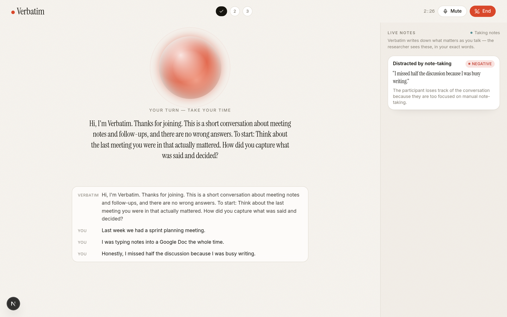

# Verbatim

**User interviews at the scale of a survey — in the participant's own words.**

Verbatim is an AI-moderated research interviewer. A researcher writes a discussion guide and gets a link; participants have a real spoken conversation with an interviewer that asks follow-ups, waits while they think, and never cuts them off; and the researcher gets a dashboard of ranked themes, verbatim quotes with audio playback, and sentiment — synthesised across every interview.

Built for the [AssemblyAI Voice Agent Hackathon](https://lablab.ai/ai-hackathons/assemblyai-voice-agent-hackathon) on the **Voice Agent API**, **LLM Gateway**, and **session recordings**.

> **Try it:** open the demo, click *Try a 3-minute interview*, talk, then open *See what the researcher sees*.


| The interview — live notes in the participant's exact words | The researcher's dashboard — themes ranked by evidence |
|---|---|
|  |  |

---

## Why

Moderated user interviews are the highest-signal research method and the least scalable one: a researcher can run maybe five a day, so teams settle for surveys. AI interviewers exist, but the ones people have tried share one flaw — they interrupt you mid-thought, because a pause to think looks like the end of an answer to a VAD timer. Verbatim is built on AssemblyAI's semantic turn detection, so the interviewer waits like a person would. That is the whole product: a conversation that feels like talking to a good researcher, plus the write-up you'd expect from one.

## What it does

**Researcher**
0. `/signup` — a username and a password. Studies, interviews, transcripts and recordings belong to the account that created them, and are invisible to every other account.
1. `/new` — write a title, research goal, and 3–6 open questions (optional probes, vocabulary hints, participant language, voice).
2. `/s/[study]` — the dashboard: participant link, interviews as they land (live, while someone is talking), per-interview write-ups, and **Synthesise** → ranked themes with prevalence ("3 of 4 participants"), sentiment, cited quotes, tensions, recommendations, and questions for the next round. Each quote from a real session has a **Hear it** button that plays the moment the participant said it.

**Participant**

Participants never sign in and never create an account. They open a share link and talk.

1. `/i/[study]` — a short intro, optional name, mic permission.
2. A voice conversation with Verbatim. Live captions, a transcript, and (in demo mode) the interviewer's notes appearing in the sidebar as they talk.
3. A thank-you page with the write-up of what they said, and a link to the researcher's view.

## How it uses AssemblyAI

| Piece | AssemblyAI product | Detail |
|---|---|---|
| The interviewer | **Voice Agent API** (`wss://agents.assemblyai.com/v1/ws`) | One WebSocket carries speech recognition, the conversational model, TTS and turn-taking. Sessions are configured inline (`session.update`) from the study: system prompt built from the discussion guide, per-study `keyterms` + `transcription_prompt`, optional `language_codes`, voice. Turn detection is left on the adaptive/semantic defaults on purpose. |
| Live notes | **Voice Agent API — client-side tools** | The interviewer calls `capture_insight` (theme, verbatim quote, note, sentiment, topic) silently before it replies, `mark_topic_complete` as the guide is covered, and `end_interview` to close. Tools run in `hold` mode; results are returned only after `reply.done`, per the docs. The browser re-checks every quote against the participant's actual transcript before saving it. |
| Time-boxing | **Voice Agent API — `reply.create`** | When the study's target length is reached, the page waits for the current exchange to finish, sends a one-shot instruction for a spoken goodbye, and ends the session itself when that reply completes — with a hard stop as the safety net. |
| Browser audio | **Voice Agent API — token auth** | The server mints single-use tokens (`GET /v1/token`, `Bearer` auth); the API key never reaches the browser. Mic audio is captured in an `AudioWorklet`, resampled to 24 kHz PCM16, sent as `input.audio`; `reply.audio` is scheduled gaplessly and flushed on barge-in. `session.end` is sent on hang-up and `pagehide`. |
| Write-ups & synthesis | **LLM Gateway** (`/v1/chat/completions`) | One call when an interview ends (headline, summary, sentiment, key quotes, pain points, wants) and one per synthesis (themes cite quote codes that map back to real notes). Validated with zod and retried with the error fed back. |
| Quote playback | **Session history** (`GET /v1/sessions/{id}`) | The stereo OGG recording (left = participant, right = interviewer) and the per-turn timeline give each quote a timestamp; the dashboard seeks straight to it. Pre-signed URLs are never stored — they're re-fetched on demand. |

## Architecture

```
browser (participant)                      Next.js (Vercel)                         AssemblyAI
────────────────────                       ────────────────                         ──────────
/i/[study]  ── POST /api/interviews ─────▶ mint token, build session config ──────▶ GET /v1/token
            ◀─ { token, sessionConfig } ──
            ── wss ?token=… session.update ───────────────────────────────────────▶ Voice Agent API
            ◀─ transcript.* / reply.* / tool.call ─────────────────────────────────
            ── POST /api/interviews/:id/turns, /insights, /events ──▶ libSQL (Turso)
            ── session.end; POST /api/interviews/:id/complete ──────▶ LLM Gateway (write-up)

/s/[study]  ── GET /api/studies/:id (polls) ◀── libSQL
            ── POST /api/studies/:id/synthesize ─────────────────────▶ LLM Gateway (synthesis)
            ── GET /api/interviews/:id/audio|timeline ───────────────▶ GET /v1/sessions/:id → artifacts
```

- `src/lib/voice/` — the browser Voice Agent client (`client.ts`), audio capture/playback (`audio.ts`), and the worklet (`public/pcm-processor.js`).
- `src/lib/prompts.ts` — interviewer prompt, tool definitions, write-up and synthesis prompts.
- `src/lib/analyst.ts` — LLM Gateway calls with schema validation; `src/lib/llm.ts` — the gateway client.
- `src/lib/auth/` — password hashing, sessions, participant grants and the ownership guards.
- `src/db/schema.ts` — researchers, sessions, studies, interviews, turns, insights, syntheses (Drizzle + libSQL).

## Accounts and access

Two kinds of visitor, and only one of them has an account.

**Researchers sign in.** Every study carries a `researcher_id`, and every interview, transcript, note and recording reaches the dashboard through it. Ownership is the *predicate of the query*, not a check afterwards — the guards in `src/lib/auth/guards.ts` will not load a row that belongs to someone else, so there is no window in which the wrong data is in hand. A study you do not own answers **404**, identically to one that does not exist, so ids cannot be probed.

**One study is published.** The seeded demo carries `is_public`, which makes its dashboard, interview pages, transcripts and recordings readable by anyone with the link and no account — so a visitor can see both halves of the product before signing up. It is the only study with the flag: every study created through the app is private, and there is no UI to change that. Publishing widens *reading* only. Synthesis still belongs to the owner, so a visitor cannot spend the study's API budget, and a stranger cannot publish their way into anyone else's data.

**Participants never sign in.** A share link is all they need, and `/i/[study]` reads nothing but the discussion guide. When an interview starts, the server sets a signed, HTTP-only *grant* cookie naming that one interview id. It carries no identity — it only proves this browser started this conversation — and the write endpoints require it. Without it, anyone who guessed an interview id could inject transcript turns or fabricate "verbatim" quotes into a stranger's study.

| Concern | How |
|---|---|
| Passwords | scrypt (N=2¹⁵, r=8), 16-byte random salt per password, ~100 ms per verification. `node:crypto` only, no native dependency. Verified with `timingSafeEqual`. |
| Sessions | A 256-bit random token in the cookie; the database stores only its SHA-256, so a database leak cannot be replayed as a login. 30-day absolute lifetime, 14-day idle expiry, enforced in the query. |
| Cookies | `HttpOnly`, `SameSite=Lax`, `Path=/`, and `Secure` in production. |
| Sign-out | Deletes the session row first, then clears the cookie — the captured token is dead server-side, not merely dropped by the client. Other browsers stay signed in. |
| CSRF | `SameSite=Lax` plus an `Origin` check on every state-changing route. |
| Account enumeration | An unknown username and a wrong password return the same status and the same message, and cost the same time (`fakeVerify`). |
| Brute force | Windowed failed-attempt counters: 10 per username per 15 minutes, 60 per IP. The per-IP limit is loose on purpose so one person's typos cannot lock out an office behind the same NAT. |
| Recordings | `/api/interviews/[id]/audio` and `/timeline` follow the study: owner-only unless it is published. The pre-signed AssemblyAI URL is minted only after that check. A participant grant does **not** unlock them. |
| Redirects | `?next=` accepts a same-origin path and nothing else (`src/lib/auth/next-path.ts`). |
| Publishing | `is_public` is off by default, settable only by the seed, and grants reading but never writing. |

`AUTH_SECRET` signs participant grants and is **required in production** — the app refuses rather than falling back to a public constant.

## Run it locally

```bash
pnpm install
cp .env.example .env            # add ASSEMBLYAI_API_KEY
pnpm db:push                    # creates ./local.db
pnpm db:seed                    # demo researcher + demo study + 4 sample interviews
pnpm dev                        # http://localhost:3000
```

The seed creates the demo study, published so `/s/demo` opens for anyone, and the account that owns it — username `demo`, password `verbatim-demo-2026` (override with `DEMO_RESEARCHER_PASSWORD`). Sign in as `demo` to re-synthesise it; create your own account at `/signup` for private studies. Participants need neither.

Environment:

| Variable | Purpose |
|---|---|
| `ASSEMBLYAI_API_KEY` | AssemblyAI key (server only). |
| `DATABASE_URL`, `DATABASE_AUTH_TOKEN` | libSQL. `file:./local.db` locally; a Turso URL + token in production. |
| `AUTH_SECRET` | Signs participant interview grants. **Required in production** (≥16 chars): `openssl rand -base64 32`. Locally it falls back to a development key. |
| `DEMO_RESEARCHER_PASSWORD` | Password for the seeded `demo` account. Only read by `pnpm db:seed`. |
| `LLM_MODEL` | LLM Gateway model id. Defaults to `qwen3.5-4b-32k-fast`, which every account can use. On a paid AssemblyAI account set e.g. `claude-sonnet-4-6` for better write-ups. |
| `NEXT_PUBLIC_APP_URL` | Public URL, used for share links and metadata. |

> **Account tiers.** On a free AssemblyAI account the LLM Gateway is limited to the small Qwen model and ~2 requests / 30 s; Verbatim is designed around that (live notes come from the interviewer's tool calls, and the Gateway is only called at the end of an interview and for synthesis). A paid account unlocks Claude/GPT/Gemini and 30 req/min per model — just change `LLM_MODEL`.

## Deploy

1. Create a [Turso](https://turso.tech) database (free tier is plenty). Put its `libsql://…` URL in `DATABASE_URL` and the token in `DATABASE_AUTH_TOKEN`.
2. Generate a signing key: `openssl rand -base64 32` → `AUTH_SECRET`.
3. With those variables in your shell or `.env`, run `pnpm db:push && pnpm db:seed` on a **new** database to create the schema, the demo researcher and the published demo study (the seed makes ~5 Gateway calls; on a free AssemblyAI account that takes about 90 s because of rate limits). For a database that already holds studies, use `pnpm db:migrate-auth --apply` instead — see below.
4. Import the repo into [Vercel](https://vercel.com/new) and set `ASSEMBLYAI_API_KEY`, `AUTH_SECRET`, `DATABASE_URL`, `DATABASE_AUTH_TOKEN`, `NEXT_PUBLIC_APP_URL` (your Vercel URL) and optionally `LLM_MODEL` / `NEXT_PUBLIC_REPO_URL`. Route handlers that call the Gateway declare `maxDuration` so they fit the Hobby plan.
5. Open `/i/demo`, do one real interview yourself, then sign in as `demo` and press *Re-synthesise* (or run `pnpm synthesize`) so the synthesis includes a recording-backed interview with a working **Hear it** button.

> Anyone who takes the demo interview has their transcript, notes and recording published at `/s/demo`. The intro page says so. Keep `is_public` off for studies with real participants — it is off by default and only the seed sets it.

**Clearing studies.** `pnpm db:reset-studies` deletes studies and everything attached to them — interviews, transcripts, notes and syntheses. It is irreversible and needs `--yes`:

```bash
pnpm db:reset-studies                     # list what is there, delete nothing
pnpm db:reset-studies --orphans --yes     # only studies with no owner
pnpm db:reset-studies --all --yes         # everything
pnpm db:reset-studies --id abc123 --yes   # one study
pnpm db:seed                              # recreate the published demo
```

### Upgrading a database that predates authentication

> **Do not use `drizzle-kit push` for this.** `is_public` is NOT NULL, which makes SQLite rebuild the `studies` table, and `push --force` rebuilds it by dropping what is there. On a database with real data it empties `studies`, cascades into `interviews`, and *then* reports an error. Verified, not theoretical.

`pnpm db:migrate-auth` does the same migration with `CREATE TABLE IF NOT EXISTS` and `ALTER TABLE ADD COLUMN` only. Every statement is additive and idempotent, and it prints the row counts before and after so you can see nothing moved.

```bash
pnpm db:migrate-auth            # show what is missing, change nothing
pnpm db:migrate-auth --apply    # apply it
```

Existing studies come out ownerless. That is fail-closed rather than public — every read requires the owner to equal the signed-in researcher, and NULL matches nobody — so they are invisible until claimed. Create an account at `/signup`, then:

```bash
pnpm db:adopt                       # list the ownerless studies
pnpm db:adopt <username>            # hand them all to that account
pnpm db:adopt <username> <studyId>  # or one at a time
```

`pnpm db:push` remains the right command for an empty database.

Other scripts: `pnpm shots` (screenshots), `pnpm deck` (rebuild `pitch/deck.pdf`), `pnpm db:studio` (browse the database).

## Test

The golden path is covered end-to-end with a fake microphone: Chrome plays a WAV of a scripted participant into the real interview page, the real Voice Agent session runs, and the script checks the transcript, live notes, thank-you page, dashboard and detail page.

Authentication and authorization have their own suite, which needs no microphone: it creates two throwaway researchers and then tries every way one could reach the other's studies, interviews, transcripts, timelines and recordings — plus the participant paths and the published demo, which must keep working with no account at all.

```bash
pnpm dev &
pnpm e2e:auth                                             # auth + authorization (83 checks)
pnpm e2e                                                  # golden path (add --headed 1 to watch)
pnpm e2e --end-after 45                                   # participant presses End
pnpm e2e --wav e2e/participant-timeup.wav --done-timeout 330   # the 3-minute clock wraps it up
pnpm typecheck && pnpm lint && pnpm build
```

`pnpm e2e` runs entirely signed out, which is the real golden path: the participant never has an account and the demo dashboard is published. `pnpm e2e:auth` is what proves every other study stays private.

The WAV fixtures are generated from the Voice Agent's own TTS (see `e2e/`); they're git-ignored, so regenerate or record your own 48 kHz mono WAV.

## Honest notes

- The four seeded interviews use scripted transcripts and notes (marked *sample* in the UI) so the dashboard isn't empty on day one; their write-ups and the synthesis are produced by the real pipeline. Interviews judges take themselves are fully real, recording included.
- Participants can see the interviewer's notes in demo mode. Real studies should turn this off (a checkbox on the study) so notes don't steer answers.
- Verbatim speaks six languages and understands eighteen; `language_codes` on the study pins one for transcription.

## Roadmap

- Phone participation via Twilio SIP (stored agents + `session.completed` webhooks), so recruits can dial in.
- Team workspaces — several researchers sharing one study, on top of the per-account ownership that exists now; export to Notion/Docs; participant screening questions.
- Analyst "whispers" — a second model suggesting probes to the interviewer mid-conversation, once `conversation.message` steering is available.

## License

MIT — see [LICENSE](./LICENSE).
