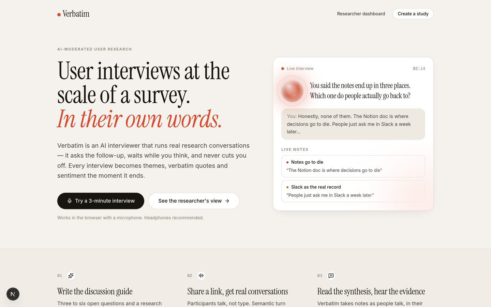
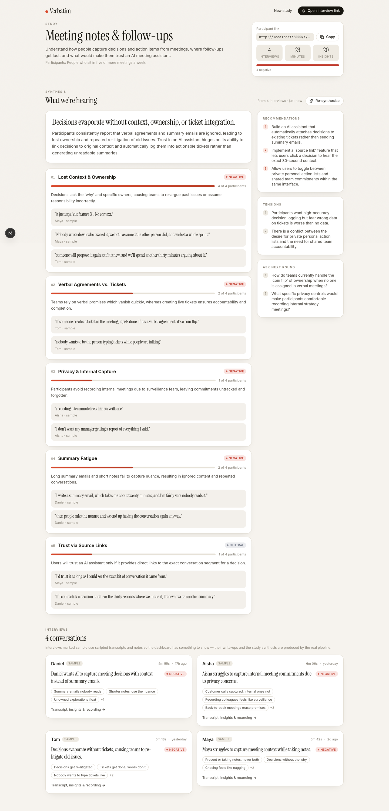

# Verbatim

**User interviews at the scale of a survey — in the participant's own words.**

Verbatim is an AI-moderated research interviewer. A researcher writes a discussion guide and gets a link; participants have a real spoken conversation with an interviewer that asks follow-ups, waits while they think, and never cuts them off; and the researcher gets a dashboard of ranked themes, verbatim quotes with audio playback, and sentiment — synthesised across every interview.

Built for the [AssemblyAI Voice Agent Hackathon](https://lablab.ai/ai-hackathons/assemblyai-voice-agent-hackathon) on the **Voice Agent API**, **LLM Gateway**, and **session recordings**.

> **Try it:** open the demo, click *Try a 3-minute interview*, talk, then open *See what the researcher sees*.



| The interview — live notes in the participant's exact words | The researcher's dashboard — themes ranked by evidence |
|---|---|
|  |  |

---

## Why

Moderated user interviews are the highest-signal research method and the least scalable one: a researcher can run maybe five a day, so teams settle for surveys. AI interviewers exist, but the ones people have tried share one flaw — they interrupt you mid-thought, because a pause to think looks like the end of an answer to a VAD timer. Verbatim is built on AssemblyAI's semantic turn detection, so the interviewer waits like a person would. That is the whole product: a conversation that feels like talking to a good researcher, plus the write-up you'd expect from one.

## What it does

**Researcher**
1. `/new` — write a title, research goal, and 3–6 open questions (optional probes, vocabulary hints, participant language, voice).
2. `/s/[study]` — the dashboard: participant link, interviews as they land (live, while someone is talking), per-interview write-ups, and **Synthesise** → ranked themes with prevalence ("3 of 4 participants"), sentiment, cited quotes, tensions, recommendations, and questions for the next round. Each quote from a real session has a **Hear it** button that plays the moment the participant said it.

**Participant**
1. `/i/[study]` — a short intro, optional name, mic permission.
2. A voice conversation with Verbatim. Live captions, a transcript, and (in demo mode) the interviewer's notes appearing in the sidebar as they talk.
3. A thank-you page with the write-up of what they said, and a link to the researcher's view.

## How it uses AssemblyAI

| Piece | AssemblyAI product | Detail |
|---|---|---|
| The interviewer | **Voice Agent API** (`wss://agents.assemblyai.com/v1/ws`) | One WebSocket carries speech recognition, the conversational model, TTS and turn-taking. Sessions are configured inline (`session.update`) from the study: system prompt built from the discussion guide, per-study `keyterms` + `transcription_prompt`, optional `language_codes`, voice. Turn detection is left on the adaptive/semantic defaults on purpose. |
| Live notes | **Voice Agent API — client-side tools** | The interviewer calls `capture_insight` (theme, verbatim quote, note, sentiment, topic) silently before it replies, `mark_topic_complete` as the guide is covered, and `end_interview` to close. Tools run in `hold` mode; results are returned only after `reply.done`, per the docs. The browser re-checks every quote against the participant's actual transcript before saving it. |
| Time-boxing | **Voice Agent API — `reply.create`** | When the study's target length is reached, the page waits for the current exchange to finish, sends a one-shot instruction for a spoken goodbye, and ends the session itself when that reply completes — with a hard stop as the safety net. |
| Browser audio | **Voice Agent API — token auth** | The server mints single-use tokens (`GET /v1/token`, `Bearer` auth); the API key never reaches the browser. Mic audio is captured in an `AudioWorklet`, resampled to 24 kHz PCM16, sent as `input.audio`; `reply.audio` is scheduled gaplessly and flushed on barge-in. `session.end` is sent on hang-up and `pagehide`. |
| Write-ups & synthesis | **LLM Gateway** (`/v1/chat/completions`) | One call when an interview ends (headline, summary, sentiment, key quotes, pain points, wants) and one per synthesis (themes cite quote codes that map back to real notes). Validated with zod and retried with the error fed back. |
| Quote playback | **Session history** (`GET /v1/sessions/{id}`) | The stereo OGG recording (left = participant, right = interviewer) and the per-turn timeline give each quote a timestamp; the dashboard seeks straight to it. Pre-signed URLs are never stored — they're re-fetched on demand. |

## Architecture

```
browser (participant)                      Next.js (Vercel)                         AssemblyAI
────────────────────                       ────────────────                         ──────────
/i/[study]  ── POST /api/interviews ─────▶ mint token, build session config ──────▶ GET /v1/token
            ◀─ { token, sessionConfig } ──
            ── wss ?token=… session.update ───────────────────────────────────────▶ Voice Agent API
            ◀─ transcript.* / reply.* / tool.call ─────────────────────────────────
            ── POST /api/interviews/:id/turns, /insights, /events ──▶ libSQL (Turso)
            ── session.end; POST /api/interviews/:id/complete ──────▶ LLM Gateway (write-up)

/s/[study]  ── GET /api/studies/:id (polls) ◀── libSQL
            ── POST /api/studies/:id/synthesize ─────────────────────▶ LLM Gateway (synthesis)
            ── GET /api/interviews/:id/audio|timeline ───────────────▶ GET /v1/sessions/:id → artifacts
```

- `src/lib/voice/` — the browser Voice Agent client (`client.ts`), audio capture/playback (`audio.ts`), and the worklet (`public/pcm-processor.js`).
- `src/lib/prompts.ts` — interviewer prompt, tool definitions, write-up and synthesis prompts.
- `src/lib/analyst.ts` — LLM Gateway calls with schema validation; `src/lib/llm.ts` — the gateway client.
- `src/db/schema.ts` — studies, interviews, turns, insights, syntheses (Drizzle + libSQL).

## Run it locally

```bash
pnpm install
cp .env.example .env            # add ASSEMBLYAI_API_KEY
pnpm db:push                    # creates ./local.db
pnpm db:seed                    # demo study + 4 sample interviews, real write-ups & synthesis
pnpm dev                        # http://localhost:3000
```

Environment:

| Variable | Purpose |
|---|---|
| `ASSEMBLYAI_API_KEY` | AssemblyAI key (server only). |
| `DATABASE_URL`, `DATABASE_AUTH_TOKEN` | libSQL. `file:./local.db` locally; a Turso URL + token in production. |
| `LLM_MODEL` | LLM Gateway model id. Defaults to `qwen3.5-4b-32k-fast`, which every account can use. On a paid AssemblyAI account set e.g. `claude-sonnet-4-6` for better write-ups. |
| `NEXT_PUBLIC_APP_URL` | Public URL, used for share links and metadata. |

> **Account tiers.** On a free AssemblyAI account the LLM Gateway is limited to the small Qwen model and ~2 requests / 30 s; Verbatim is designed around that (live notes come from the interviewer's tool calls, and the Gateway is only called at the end of an interview and for synthesis). A paid account unlocks Claude/GPT/Gemini and 30 req/min per model — just change `LLM_MODEL`.

## Deploy

1. Create a [Turso](https://turso.tech) database (free tier is plenty). Put its `libsql://…` URL in `DATABASE_URL` and the token in `DATABASE_AUTH_TOKEN`.
2. With those two variables in your shell or `.env`, run `pnpm db:push && pnpm db:seed` to create the schema and the demo study on it (the seed makes ~5 Gateway calls; on a free AssemblyAI account that takes about 90 s because of rate limits).
3. Import the repo into [Vercel](https://vercel.com/new) and set `ASSEMBLYAI_API_KEY`, `DATABASE_URL`, `DATABASE_AUTH_TOKEN`, `NEXT_PUBLIC_APP_URL` (your Vercel URL) and optionally `LLM_MODEL` / `NEXT_PUBLIC_REPO_URL`. Route handlers that call the Gateway declare `maxDuration` so they fit the Hobby plan.
4. Open `/i/demo`, do one real interview yourself, then `pnpm synthesize` (or press *Re-synthesise* on the dashboard) so the synthesis includes a recording-backed interview with a working **Hear it** button.

Other scripts: `pnpm shots` (screenshots), `pnpm deck` (rebuild `pitch/deck.pdf`), `pnpm db:studio` (browse the database).

## Test

The golden path is covered end-to-end with a fake microphone: Chrome plays a WAV of a scripted participant into the real interview page, the real Voice Agent session runs, and the script checks the transcript, live notes, thank-you page, dashboard and detail page.

```bash
pnpm dev &
pnpm e2e                                                  # golden path (add --headed 1 to watch)
pnpm e2e --end-after 45                                   # participant presses End
pnpm e2e --wav e2e/participant-timeup.wav --done-timeout 330   # the 3-minute clock wraps it up
pnpm typecheck && pnpm lint && pnpm build
```

The WAV fixtures are generated from the Voice Agent's own TTS (see `e2e/`); they're git-ignored, so regenerate or record your own 48 kHz mono WAV.

## Honest notes

- The four seeded interviews use scripted transcripts and notes (marked *sample* in the UI) so the dashboard isn't empty on day one; their write-ups and the synthesis are produced by the real pipeline. Interviews judges take themselves are fully real, recording included.
- Participants can see the interviewer's notes in demo mode. Real studies should turn this off (a checkbox on the study) so notes don't steer answers.
- Verbatim speaks six languages and understands eighteen; `language_codes` on the study pins one for transcription.

## Roadmap

- Phone participation via Twilio SIP (stored agents + `session.completed` webhooks), so recruits can dial in.
- Multi-study workspace with auth; export to Notion/Docs; participant screening questions.
- Analyst "whispers" — a second model suggesting probes to the interviewer mid-conversation, once `conversation.message` steering is available.

## License

MIT — see [LICENSE](./LICENSE).
